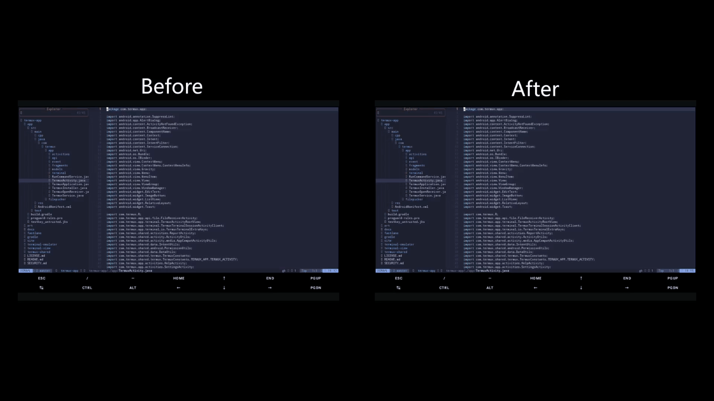
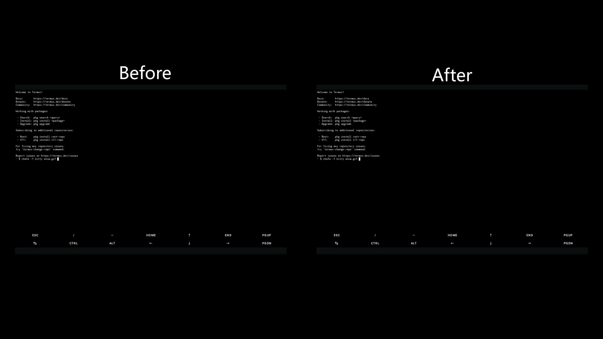

# Termux Extend

An unofficial, performance-focused build of the official [Termux](https://termux.dev) app, forked from [termux/termux-app](https://github.com/termux/termux-app) (`master` @ `8629e632`).

The fork adds, on top of upstream: `108f11d5` (*rendering optimization*), a **kitty graphics protocol** implementation, a **kitty keyboard protocol** implementation, and a **performance pass** over the terminal emulator and the renderer, including support for the synchronized output mode. Everything else is upstream.

> Not an official Termux release. Report fork-specific issues here, not upstream.

## Difference





## What's new

**Rendering** (`108f11d5`)

- **Row-batched images** — drawn once per row instead of once per cell, which is a big win for sixel and iTerm2 inline images.
- **Glyph width cache** — widths of non-ASCII code points are cached instead of re-measured for every cell on every frame (CJK, emoji).
- **Paint state diffing** — text effects are pushed to `Paint` only when they change.
- **Frame-driven fling** — `post()` replaced with `postOnAnimation()`, so scrolling updates at most once per frame.
- **Single invalidation per scroll** — one `invalidate()` per batch instead of one per row.
- **Java 17** — `app`, `terminal-emulator` and `terminal-view` now target Java 17.

**Terminal emulator and renderer**

- **Column scan cache** — a row that holds a wide or a supplementary character cannot use the fast path of `TerminalRow.setChar()`, so it scanned the row from the first column to find the index of the column being written, once for the written cell and twice more to check for wide characters. That made writing such a row quadratic in the number of columns, and since a syntax highlighted application like LazyVim uses Nerd Font icons that live in the supplementary plane, nearly every row took that path. The scan now continues from where the previous one ended and starts over only when the text before that position changed. Measured on a 127 column row: 460 → 47 ns per cell, and the cost no longer grows with the column index.
- **Per-character overhead** — the row index of the ring buffer is no longer wrapped with a modulo for every written cell, the display width of a code point is no longer looked up twice, and the checks for the string sequences are skipped with a single comparison instead of four while no escape sequence is being parsed.
- **Reader thread** — a 64 KB read buffer, and a message is only queued when none is pending instead of one message per 4 KB read, which no longer floods the main thread while it is rendering a frame.
- **Bitmap collection per batch** — unused `TerminalBitmap`s are collected once per `append()` batch instead of once per code point, which no longer takes the lock of the screen for every parsed character. The collection is throttled to once every 300 seconds, so its behaviour is unchanged.
- **Paint color diffing** — the text color is pushed to `Paint` only when it changes, and a run no longer divides the accumulated width by the font width just to decide whether it needs to be scaled.
- **Synchronized output** — the `CSI ? 2026 h` / `CSI ? 2026 l` (BSU/ESU) mode is supported, so a burst of output that an application wraps in it is presented as a single update instead of one update for every write the application makes.

**Kitty graphics protocol**

- `APC ESC_G` images with actions `t`/`T`/`p`/`d`/`q`, PNG plus raw RGB/RGBA, chunked transfer (`m=1`), zlib (`o=z`) and file transfer (`t=f`/`t=t`).
- Image numbers (`I=`), feature queries (`e=`), pixel offsets (`X`/`Y`), placement ids (`p=`) and usage hints (`N=`) are supported, as are all the delete specifiers and animations (`a=f` frames, `a=a` playback, `a=c` composition).
- Off by default. Enable it in `~/.termux/termux.properties`:

  ```properties
  kitty-graphics=true
  ```

  then run `termux-reload-settings`. Works with `kitten icat`, `chafa --format kitty`, `timg --kitty`.
- Images use the same cell bitmap model as sixel, so they scroll with the text. Not implemented: unicode placeholders and z-index stacking.

**Kitty keyboard protocol**

- `CSI > flags u`, `CSI = flags ; mode u` and `CSI < number u` push, change and pop the flags that tell which key events are reported with the extended `CSI key ; modifiers : event-type ; text u` encoding, and `CSI ? u` reports the current ones.
- The disambiguate flag reports the keys that are ambiguous in the legacy encoding, like escape, enter, tab, backspace and the keys with ctrl or alt, as escape codes instead of control characters. The flag to report all keys does the same for every key, including the functional keys. The event types flag adds press, repeat and release, and the text flag adds the text that the key produces.
- Off by default. Enable it in `~/.termux/termux.properties`:

  ```properties
  kitty-keyboard=true
  ```

  then run `termux-reload-settings`.
- Not implemented: the alternate keys flag (`4`), which reports the shifted and base layout keys.

**Input method composing**

- The `inputType` that is advertised to the input method can now have a text class set, which is required for the languages whose input methods convert what is typed into other characters, like Chinese, Japanese or Korean. Without a text class the input methods disable their composing, suggestions and long press popups, so only the characters that have their own key could be entered and those languages had to be pasted in from another text field.
- The normal text variation is used instead of the password variation, since the password variations make the input methods hide the language switch and leave the field stuck on the primary language. The suggestions flag keeps the autocorrect and the suggestions away, which would otherwise corrupt the terminal input.
- Off by default. Enable it in `~/.termux/termux.properties`:

    terminal-ime-composing = true

  then run `termux-reload-settings`.

## Compatibility

- Package name is still `com.termux`, so this **replaces** the official app. It cannot be installed alongside it, and the official app has to be uninstalled first (different signing key).
- **Back up first** — uninstalling deletes `home` and `usr`:

  ```bash
  termux-setup-storage
  tar -C /data/data/com.termux/files -cf ~/storage/shared/termux-backup.tar home usr
  ```

- Plugins, the bootstrap and installed packages are unaffected.

## Build

Requires JDK 17+, Android SDK 36 and NDK `29.0.14206865`.

```bash
./gradlew assembleDebug    # app/build/outputs/apk/debug/
./gradlew test
```

Debug APKs are signed with the bundled `testkey_untrusted.jks`; release builds are unsigned.

## Credits & License

Built on the work of the [Termux](https://termux.dev) project and of [Android Terminal Emulator](https://github.com/jackpal/Android-Terminal-Emulator) by Jack Palevich.

GPLv3 only, with Apache 2.0 exceptions for `terminal-view` and `terminal-emulator`. See [LICENSE.md](LICENSE.md).
